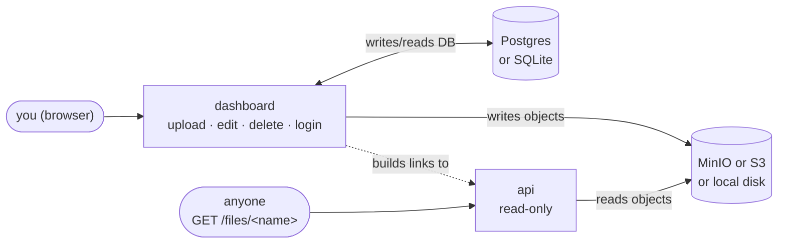

# ContentFlow

A small self-hosted asset host: upload files through a web dashboard, get
back a stable URL + copy-paste embed tag, served by a separate read-only
file server. Two Flask services, one Postgres-or-SQLite database, one
S3-or-local-disk object store.

## Architecture



- **`services/api`** — serves uploaded files at `GET /files/<name>`. No
  database, no auth, no writes. This is the only thing whose URL you'd
  actually put in an `` or `<script src>` tag.
- **`services/dashboard`** — the UI. Upload/rename/replace/delete assets,
  browse them, copy embed tags. Owns the database and all writes to object
  storage. Gated behind a login (see [Auth](#auth) below).
- **`services/shared`** — a small module (`security_headers.py`) with the
  security response headers both services apply to every response. Kept in
  one place so the policy can't drift between them.

Both services can run against either storage backend independently:
Postgres or SQLite for the dashboard's metadata DB, and MinIO/S3 or a local
bind-mounted directory for the actual file bytes. Toggle each with one env
var (see [Environment variables](#environment-variables)).

## Quickstart

```bash
cp .env.example .env
# edit .env: at minimum set DASHBOARD_SECRET_KEY, ADMIN_USERNAME, ADMIN_PASSWORD
docker compose up --build
```

- Dashboard: http://localhost:5001 — log in with `ADMIN_USERNAME` /
  `ADMIN_PASSWORD` from `.env`.
- API (file server): http://localhost:5000/files/\<name\>

The example config defaults to `STORAGE_BACKEND=local` and
`DB_BACKEND=sqlite`, so `docker compose up` works with nothing else running
— no Postgres or MinIO container needed. Switch either one on to get the
Postgres/MinIO containers included automatically (see below).

### Switching backends

`COMPOSE_PROFILES` controls which extra containers `docker compose` starts,
and must be kept in sync with the two backend toggles by hand:

| `DB_BACKEND` | `STORAGE_BACKEND` | `COMPOSE_PROFILES` |
|---|---|---|
| `sqlite`   | `local` | *(empty)* |
| `postgres` | `local` | `postgres` |
| `sqlite`   | `s3`    | `s3` |
| `postgres` | `s3`    | `s3,postgres` |

The `postgres` and `minio`/`minio-init` services in `docker-compose.yml` are
gated behind the matching profile (`profiles: ["postgres"]` /
`profiles: ["s3"]`), so they simply don't start unless selected.

### Running a service without Docker

Each service is a plain Flask app with a `run.py`:

```bash
pip install -r services/dashboard/requirements.txt
python services/dashboard/run.py    # reads .env from the repo root
```

Same for `services/api`. This is how the devcontainer runs things day to
day instead of rebuilding images on every change.

## Auth

The dashboard has exactly one admin identity, configured entirely through
env vars — there is no users table and nothing is persisted to the
database. Both login methods below can be enabled independently, or both at
once:

- **`AUTH_BASIC_ENABLED`** (default `true`) — a plain username + password
  form, checked directly against `ADMIN_USERNAME` / `ADMIN_PASSWORD`.
- **`AUTH_OAUTH_ENABLED`** (default `false`) — a generic OAuth2 client.
  Works with any provider that exposes authorize/token/userinfo endpoints
  (Authentik, Okta, Auth0, Keycloak, Google, ...). By default it only
  accepts a login whose provider-returned email matches `ADMIN_USERNAME`
  (set `OAUTH_ALLOW_SIGNUP=true` to instead trust anyone the provider lets
  authenticate — see the var reference below).

At least one of the two must be enabled, or the app refuses to start (there
would be no way to log in at all).

### Setting up OAuth (example: Authentik)

1. In your provider, create an OAuth2/OIDC application + provider for
   ContentFlow. Set its **redirect URI** to:
   ```
   https://<the domain you access the dashboard through>/login/oauth/callback
   ```
   This has to match exactly what the browser's address bar shows when
   using the dashboard — e.g. `http://localhost:5001/login/oauth/callback`
   for local dev with the default compose port mapping.
2. Copy the provider's **Client ID**, **Client Secret**, **Authorize URL**,
   **Token URL**, **Userinfo URL**, and (if using OpenID scopes) **JWKS
   URL** into the matching `OAUTH_*` vars in `.env`.
3. Set `ADMIN_USERNAME` to the email address your account will actually
   authenticate as, unless you set `OAUTH_ALLOW_SIGNUP=true`.

## Running the tests

Each service has its own self-contained pytest suite under `tests/` — no
Docker, no real Postgres/MinIO/OAuth provider needed. Tests force
`DB_BACKEND=sqlite` and `STORAGE_BACKEND=local` against temp directories
regardless of your local `.env`.

```bash
pip install -r services/api/requirements-test.txt
python -m pytest services/api/tests

pip install -r services/dashboard/requirements-test.txt
python -m pytest services/dashboard/tests
```

## CI/CD

- **`.github/workflows/test.yml`** — runs both services' test suites on
  every push and pull request.
- **`.github/workflows/create-docker-on-release.yml`** — on every GitHub
  Release, builds multi-arch (`amd64`/`arm64`/`arm/v7`) images for both
  services and pushes them to GHCR as `ghcr.io/<owner>/contentflow-api` and
  `ghcr.io/<owner>/contentflow-dashboard`, tagged with the release version
  (plus a floating `latest`). Cutting a release is the only thing that
  triggers a build — pushes to a branch don't publish images.

## Environment variables

All of these live in `.env` at the repo root (see `.env.example`), read by
`docker compose` (`env_file: .env`) and by both services directly via
`python-dotenv`. Vars are grouped by what they configure; "required when"
means the app raises at startup if it's missing under that condition.

### Backend toggles

| Var | Default | Notes |
|---|---|---|
| `DB_BACKEND` | `postgres` | `postgres` or `sqlite`. Dashboard only — the API service has no database. |
| `STORAGE_BACKEND` | `s3` | `s3` or `local`. Used by both services. |
| `COMPOSE_PROFILES` | *(empty)* | Must be kept in sync with the two above — see the table under [Switching backends](#switching-backends). Read by `docker compose` itself, not by the apps. |

### SQLite (`DB_BACKEND=sqlite`)

| Var | Default | Notes |
|---|---|---|
| `SQLITE_PATH` | `/data/dashboard.db` | Relative paths resolve against the repo root (where `.env` lives), not the process's cwd, so it behaves the same whether launched via Docker, `docker compose`, or `python run.py` from anywhere. |

### Postgres (`DB_BACKEND=postgres`)

| Var | Default | Required |
|---|---|---|
| `POSTGRES_USER` | — | yes |
| `POSTGRES_PASSWORD` | — | yes |
| `POSTGRES_DB` | — | yes |
| `POSTGRES_HOST` | `postgres` | no |
| `POSTGRES_PORT` | `5432` | no |

`POSTGRES_USER`/`PASSWORD`/`DB` also configure the `postgres` container
itself in `docker-compose.yml`, not just the app's connection string.

### Local disk storage (`STORAGE_BACKEND=local`)

| Var | Default | Notes |
|---|---|---|
| `LOCAL_STORAGE_PATH` | `/data/storage` | Same repo-root-relative resolution as `SQLITE_PATH`. Used by both services. |

### S3 / MinIO (`STORAGE_BACKEND=s3`)

| Var | Default | Required | Notes |
|---|---|---|---|
| `S3_ENDPOINT_URL` | — | yes | |
| `S3_ACCESS_KEY` | — | yes | |
| `S3_SECRET_KEY` | — | yes | |
| `S3_BUCKET` | — | yes | |
| `S3_REGION` | `us-east-1` | no | |
| `S3_PUBLIC_ENDPOINT_URL` | — | no | Informational only — not read by either service. For your own reference (e.g. the browser-reachable MinIO console URL, if different from `S3_ENDPOINT_URL`). |
| `MINIO_ROOT_USER` | — | yes* | Only used by the `minio`/`minio-init` containers, not the apps. *Required if the `s3` compose profile is active. |
| `MINIO_ROOT_PASSWORD` | — | yes* | Same as above. |

### API service

| Var | Default | Notes |
|---|---|---|
| `CSP_POLICY` | `default-src 'none'; img-src 'self'; style-src 'self'` | Overrides the shared module's HTML-oriented CSP — this service only ever streams raw file bytes, so it needs its own minimal, restrictive policy instead. |

### Dashboard service

| Var | Default | Required | Notes |
|---|---|---|---|
| `DASHBOARD_SECRET_KEY` | — | yes | Signs session cookies and CSRF tokens. Generate with `openssl rand -base64 24`. |
| `API_PUBLIC_URL` | `http://localhost:5000` | no | Used to build the links/embed tags shown in the dashboard — this must be the URL *your browser* can reach the API service at, which may differ from the API's internal container address. |
| `MAX_UPLOAD_MB` | *(unset = unlimited)* | no | Caps upload size. |
| `FLASK_DEBUG` | — | no | Read directly by Flask (not app code): enables the interactive debugger + auto-reload. **Never set this in production** — the debugger allows arbitrary code execution. |

### Dashboard login

| Var | Default | Required | Notes |
|---|---|---|---|
| `AUTH_BASIC_ENABLED` | `true` | no | See [Auth](#auth). |
| `AUTH_OAUTH_ENABLED` | `false` | no | See [Auth](#auth). At least one of `AUTH_BASIC_ENABLED`/`AUTH_OAUTH_ENABLED` must be `true`. |
| `ADMIN_USERNAME` | — | yes | The one admin identity. Compared case-insensitively. |
| `ADMIN_PASSWORD` | — | yes, if `AUTH_BASIC_ENABLED` | |
| `OAUTH_CLIENT_ID` | — | yes, if `AUTH_OAUTH_ENABLED` | |
| `OAUTH_CLIENT_SECRET` | — | yes, if `AUTH_OAUTH_ENABLED` | |
| `OAUTH_AUTHORIZE_URL` | — | yes, if `AUTH_OAUTH_ENABLED` | |
| `OAUTH_TOKEN_URL` | — | yes, if `AUTH_OAUTH_ENABLED` | |
| `OAUTH_USERINFO_URL` | — | yes, if `AUTH_OAUTH_ENABLED` | |
| `OAUTH_JWKS_URL` | *(unset)* | only if `OAUTH_SCOPE` includes `openid` | The provider returns a signed `id_token` whenever the scope includes `openid` (the default), and Authlib verifies its signature against this endpoint. Omitting it while using an `openid` scope fails at login time with `Missing "jwks_uri" in metadata`. |
| `OAUTH_SCOPE` | `openid email profile` | no | |
| `OAUTH_EMAIL_FIELD` | `email` | no | Key in the userinfo JSON response holding the user's email — providers disagree on this; `email` covers OIDC-compliant ones. |
| `OAUTH_ALLOW_SIGNUP` | `false` | no | `false`: only a login whose email matches `ADMIN_USERNAME` is accepted. `true`: any user who successfully authenticates with the provider is let in — use this when the provider itself is already the access boundary (e.g. only invited users can authenticate against your Authentik application at all), so there's no separate local allow-list to maintain. |

## Branding

The dashboard's logo and favicon live in
`services/dashboard/app/static/img/` (`logo.svg`, `favicon.svg`). The favicon
is wired up via a `<link rel="icon">` in `base.html`; the logo is inlined
directly into the nav (rather than loaded via ``) so its wordmark can
pick up the current theme color in dark mode.

## License

MIT — see [LICENSE](LICENSE).
